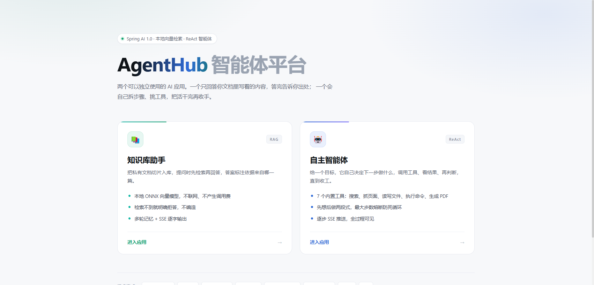
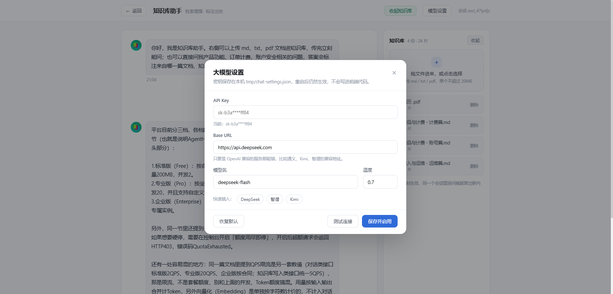
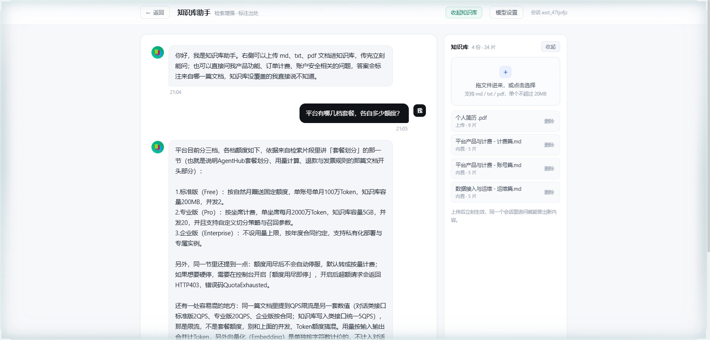
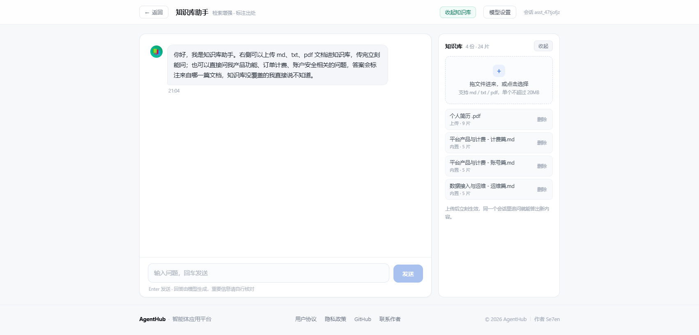
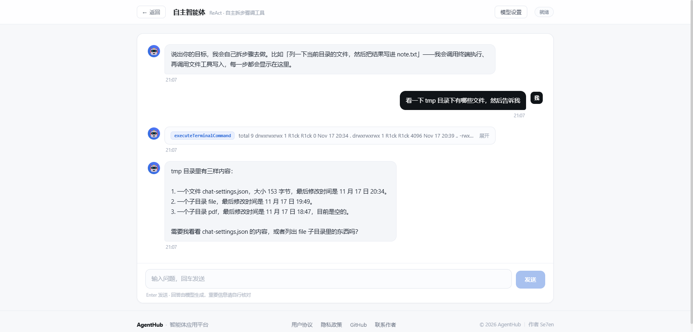
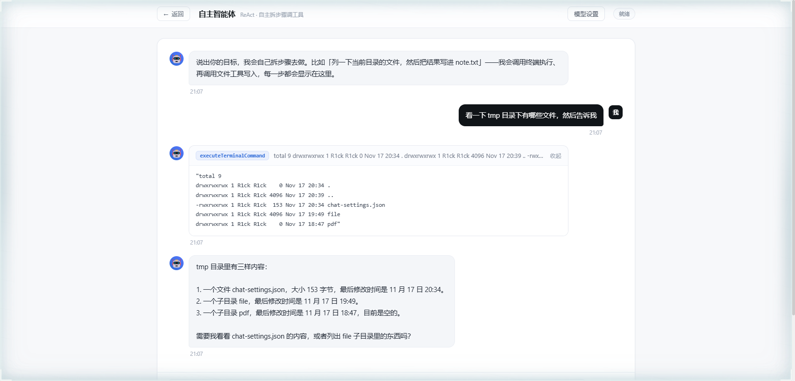

# AgentHub · 智能体应用平台

一个基于 Spring AI 1.0 的 AI 应用平台，**克隆下来三步就能跑**。两个可独立使用的应用：

| 应用 | 做了什么 | 关键能力 |
|---|---|---|
| **知识库助手** | 把私有文档切成片段向量化入库，提问时先检索再回答 | 检索增强（RAG）、回答标注出处、答不出明确拒答、多轮记忆、文档上传 |
| **自主智能体** | 一个会自己拆步骤、挑工具、看结果的 ReAct 智能体 | 工具调用、ReAct 循环、最大步数熔断、SSE 逐步推送 |

前端 Vue 3 + Vite，后端 Spring Boot 3 + Java 21。**向量化在本地用 ONNX 跑，不依赖任何 Embedding API、不产生费用**；对话模型走任何 OpenAI 兼容接口，默认 DeepSeek。



---

## 一、下载即用

### 三步跑起来

```bash
git clone https://github.com/Se7en-exe/agenthub.git
cd agenthub

# 打包（跳过测试：测试会真的调外部模型）
./mvnw clean package -DskipTests
#  Windows: mvnw.cmd clean package -DskipTests，或已装 Maven 时 mvn clean package -DskipTests

# 启动
java -Djava.io.tmpdir=./tmp -jar target/agenthub-0.0.1-SNAPSHOT.jar
```

Windows 可以直接双击根目录的 `start.bat`，里面把 JDK 查找、tmp 目录、编码参数都处理好了。然后打开 <http://127.0.0.1:8123/api/>。

> 启动参数里的 `-Djava.io.tmpdir=./tmp` 不是可有可无的。Windows 上 `java.io.tmpdir` 常常指向一个没写权限的目录，Tomcat 会报 `Unable to create tempDir` 直接起不来。程序启动时会自动把 `./tmp` 和 `java.io.tmpdir` 指到的目录建出来，所以克隆后不必先手建。

### API Key 怎么给

**不用改任何配置文件。** 启动后点页面右上角「模型设置」，填 key、保存即可：



- 保存前会用这组参数真发一次请求，**通了才落盘**；填错只提示原因，不会把服务改坏
- key 落在 `tmp/chat-settings.json`，重启还在（`tmp` 已在 `.gitignore` 里，不会误提交）
- 也可以走环境变量，优先级低于页面保存的值，适合 Docker / CI：

```bash
set DEEPSEEK_API_KEY=sk-xxxxxxxx                  # 必填
set DEEPSEEK_BASE_URL=https://api.deepseek.com    # 可选，换别的兼容服务时改
set DEEPSEEK_MODEL=deepseek-flash                 # 可选
set SERVER_PORT=8123                              # 可选
```

弹窗里内置 DeepSeek / 智谱 / Kimi 三个服务商的快捷填入，换一家只需填对应的 key。

> 完全不给 key 也能启动，只是对话会明确提示「API Key 无效或未配置」。这是刻意设计的，见第五节 5.3。

### 环境要求

- **JDK 21**（`pom.xml` 里 `java.version=21`，用 17 会报 `UnsupportedClassVersionError: class file version 65.0`）
- Node.js 18+（只在改前端时需要；`src/main/resources/static/` 里已带构建产物）
- Maven 3.9+，或直接用自带的 `mvnw`
- 不需要 Docker、不需要数据库、不需要本地装 Ollama

---

## 二、页面

| 地址 | 说明 |
|---|---|
| <http://127.0.0.1:8123/api/> | 首页 |
| <http://127.0.0.1:8123/api/assistant> | 知识库助手 |
| <http://127.0.0.1:8123/api/agent> | 自主智能体 |
| <http://127.0.0.1:8123/api/swagger-ui.html> | 接口文档 |
| <http://127.0.0.1:8123/api/health> | 健康检查 |

### 知识库助手



右侧面板可以直接拖 md / txt / pdf 上传进知识库，传完立刻能问，上传的文档和内置三篇语料一起参与检索。



### 自主智能体



工具执行结果会折叠成一个可展开的小块，不会把整坨 JSON 糊在聊天区：



---

## 三、代码结构

```
agenthub/
├── src/main/java/com/lws/agenthub/
│   ├── agent/            BaseAgent / ReActAgent / ToolCallAgent / AutoAgent
│   ├── tools/            7 个工具：文件读写、联网搜索、网页抓取、资源下载、终端执行、PDF 生成、终止
│   ├── rag/              文档加载、向量库、知识库服务、检索顾问、查询改写
│   ├── config/           ChatSettings / ChatModelProvider / ModelErrors
│   ├── chatmemory/       按会话 ID 落盘的对话记忆（Kryo 序列化）
│   ├── advisor/          日志顾问、重读顾问
│   ├── app/              KnowledgeAssistant（知识库助手）
│   ├── controller/       HTTP 接口、知识库上传、模型设置、SPA 路由转发
│   └── demo/             框架能力的独立示例（可忽略）
├── src/main/resources/
│   ├── document/         知识库语料（Markdown，文件名「 - 」后缀作分类标签）
│   ├── onnx/             本地向量模型（bge-small-zh-v1.5 量化版，24 MB）与分词器
│   └── static/           前端构建产物
├── agenthub-frontend/    Vue 3 前端源码
├── image-search-mcp-server/   独立 MCP 工具服务（stdio / sse 两种模式）
└── docs/                 README 用的截图
```

---

## 四、几个实现上值得看的地方

### 4.1 检索增强（RAG）

**离线阶段**：`KnowledgeDocumentLoader` 扫描 `classpath:document/*.md`，按水平分割线切片段，写入 `filename` 与 `category` 元数据。分类标签取自文件名的「 - 」后缀，所以语料命名规则是 `领域 - 分类.md`。

**向量化**：`spring-ai-starter-model-transformers` 加载本地 ONNX 模型（`bge-small-zh-v1.5` 量化版），进程内推理，不出网、不花钱。输出层取 `last_hidden_state` 做 mean pooling。

**在线阶段**：提问先过 `QueryRewriter` 改写（把口语补成完整问句），再过 `QuestionAnswerAdvisor` 检索，取 TopK 片段塞进上下文。检索不到超过阈值的片段时，`ContextualQueryAugmenter` 拦住模型不让它自由发挥，直接返回固定拒答文案。

### 4.2 运行期可换的 ChatModel

Spring AI 的 `OpenAiChatModel` 是**不可变对象**，key 在构造时固化进 `OpenAiApi`，没有 setter。要支持页面换 key，硬改会让所有注入 `ChatModel` 的组件跟着改。

这里的做法是自己实现 `ChatModel` 接口做一层代理，内部用 volatile 字段持有真身：

```java
@Component
public class ChatModelProvider implements ChatModel {

    private volatile OpenAiChatModel delegate;

    public synchronized void rebuild() {
        this.delegate = build(settings.getApiKey(), settings.getBaseUrl(),
                              settings.getModel(), settings.getTemperature(), null);
    }

    @Override public ChatResponse call(Prompt p)         { return delegate.call(p); }
    @Override public Flux<ChatResponse> stream(Prompt p) { return delegate.stream(p); }
    @Override public ChatOptions getDefaultOptions()     { return delegate.getDefaultOptions(); }
}
```

上层组件一行都不用改，注入到的是壳，永远用当前实例。配套把 `spring.ai.model.chat` 设成 `none` 关掉自动配置，全应用只剩一个 `ChatModel` Bean，避免两个候选注入不进去。

### 4.3 ReAct 智能体

`BaseAgent` 管状态机（IDLE / RUNNING / FINISHED / ERROR）与步数上限；`ReActAgent` 把一步拆成 `think()` 和 `act()`：

```java
public String step() {
    boolean shouldAct = think();
    setActionRequired(shouldAct);
    if (!shouldAct) {
        // 模型这一轮直接给了答案，把它的原话当结果返回，循环随即结束
        String thought = getThought();
        return thought == null || thought.isBlank() ? "这一轮没有需要执行的动作。" : thought;
    }
    return act();
}
```

`ToolCallAgent` 关掉了框架自带的工具执行，改成手动调度：

```java
OpenAiChatOptions.builder().internalToolExecutionEnabled(false).build()          // 只让模型返回 tool_call
ToolExecutionResult r = toolCallingManager.executeToolCalls(prompt, response);  // 由我们自己执行
setMessageList(r.conversationHistory());                                        // 结果写回上下文
```

好处是每一步都能插钩子：记日志、算耗时、限制单工具调用次数、检查是否该终止。终止靠模型主动调 `terminate`，`act()` 里检查 `response.name().equals("doTerminate")` 后把状态翻成 `FINISHED`；`maxSteps` 是兜底，防止模型陷在循环里出不来。

---

## 五、踩过并修掉的坑

这些都得真跑起来才会暴露，而且现象和根因离得很远，逐个记下来。

### 5.1 `.tools()` 传 `ToolCallback[]` 会静默空转

`ChatClient.prompt().tools(ToolCallback[])` 运行时报 `No @Tool annotated methods found in MethodToolCallback{...}. Did you mean to pass a ToolCallback or ToolCallbackProvider?`。这个异常被 `think()` 的 `catch` 吞掉，表现成智能体空转——20 步全是「思考完成 - 无需行动」，很难从现象反推。正确写法是 `.toolCallbacks(...)`。

### 5.2 `think()` 吞掉异常，真实失败原因被盖掉

原实现 `catch (Exception e) { return false; }`，而 `step()` 在 `!shouldAct` 时返回一句固定文案。于是 key 失效、网络不通、模型名写错，界面上全是同一句「这一轮没有需要执行的动作」。

现在把原因写进 `thought`，并用统一的 `ModelErrors` 翻成中文：

| 原始报错 | 界面上看到的 |
|---|---|
| 401 / InvalidApiKey | API Key 无效或未配置，点右上角「模型设置」填一个可用的 key（401） |
| 402 / insufficient_quota | 账户余额不足，请到服务商后台充值（402） |
| 403 | 这个 key 无权调用当前模型，或模型名写错了（403） |
| 404 | 接口地址或模型名不对（404），核对 Base URL 与模型名 |
| 429 | 请求太频繁，稍等几秒重试（429） |
| 超时 / 连接失败 | 连不上模型服务，检查网络和 Base URL 是否可达 |

### 5.3 向量库 Bean 把外部服务变成了启动强依赖

原实现把「加载文档 → 调模型补关键词 → 写向量库」全写在 `@Bean` 方法里，容器启动阶段同步执行。只要外部服务不可用（没配 key / 额度用尽 / 网络不通），`KeywordMetadataEnricher` 抛 401，整条 `APPLICATION FAILED TO START`，连不依赖向量库的接口都访问不到。

现在 `@Bean` 只返回一个委托壳，真正的构建推迟到第一次读写向量库时（双重检查锁），且关键词增强失败降级为原始文档。**缺 key 也能把应用起来**，只是调知识库问答时才报错。

### 5.4 终端工具的中文编码

`InputStreamReader` 不指定字符集时用 JVM 默认编码，而启动参数 `-Dfile.encoding=UTF-8` 把默认改成了 UTF-8，`cmd.exe` 在某些机器上吐 GBK，中文全乱。写死 GBK 又会在代码页已是 65001 的机器上反向乱码（本项目就踩了两次）。

最终做法是先按 UTF-8 严格解码，抛 `CharacterCodingException` 才回退 GBK：

```java
static String decode(byte[] bytes) {
    try {
        return StandardCharsets.UTF_8.newDecoder()
                .onMalformedInput(CodingErrorAction.REPORT)
                .onUnmappableCharacter(CodingErrorAction.REPORT)
                .decode(ByteBuffer.wrap(bytes)).toString();
    } catch (CharacterCodingException e) {
        return new String(bytes, GBK);
    }
}
```

配套加了 20 秒超时强杀、4000 字符截断、ANSI 控制符清理、12 条危险命令黑名单。

### 5.5 网页搜索工具越界

`organicResults.subList(0, 5)` 在结果不足 5 条时抛 `IndexOutOfBoundsException`，被外层 catch 转成「搜索失败」，模型会误判成工具坏了去重试。改成 `subList(0, Math.min(limit, size))`，空结果返回「没有搜到」而不是异常，并补了 6 个单测覆盖 null / 0 条 / 3 条 / 5 条 / 8 条 / limit≤0。

### 5.6 `SimpleVectorStore` 只能按 id 删，而 id 拿不回来

文档上传后 `store.add()` 内部生成的是随机 UUID，用户点「删除」时手里只有文件名。所以自建了 `KnowledgeRegistry` 反查表（文件名 → 文档 id 列表），与内存向量库同生命周期，一起清零。

### 5.7 PDF 抽取的空格爆炸

PDFBox 按字符间距输出，中文会变成「项 目 经 历」。实测一份简历真实 2465 字符，抽取结果是 11868 字符（4.8 倍）。加了 `squeeze()`：

```java
text.replaceAll("[ \\t\\u00A0]+", " ")
    .replaceAll("(?<=[\\u4e00-\\u9fff]) (?=[\\u4e00-\\u9fff])", "")   // 只删中文字间空格，保英文词间
```

压缩到 2603 字符。

---

## 六、接口

| 方法 | 路径 | 说明 |
|---|---|---|
| GET | `/api/ai/assistant/chat/rag/sse` | 知识库问答，SSE 流式（前端实际用的） |
| GET | `/api/ai/assistant/chat/rag` | 知识库问答，同步返回 |
| GET | `/api/ai/assistant/chat/sync` | 基础对话，同步返回 |
| GET | `/api/ai/assistant/chat/sse` | 基础对话，`Flux` 流式 |
| GET | `/api/ai/assistant/chat/server_sent_event` | 基础对话，`ServerSentEvent` 包装 |
| GET | `/api/ai/assistant/chat/sse_emitter` | 基础对话，`SseEmitter` 包装 |
| GET | `/api/ai/agent/chat` | 自主智能体，SSE 逐步推送 |
| GET | `/api/ai/knowledge/list` | 知识库文档列表 |
| POST | `/api/ai/knowledge/upload` | 上传文档（md / txt / pdf，单个 ≤ 20 MB） |
| DELETE | `/api/ai/knowledge/delete?name=` | 删除文档 |
| GET | `/api/ai/settings` | 当前模型配置（key 打码） |
| POST | `/api/ai/settings/test` | 试连，不保存 |
| POST | `/api/ai/settings` | 保存配置（先试连，通了才落盘） |
| POST | `/api/ai/settings/reset` | 恢复为启动时的环境变量配置 |

四个基础对话流式接口实现方式不同、结果一样——留着是为了对比 `Flux` / `ServerSentEvent` / `SseEmitter` 三种写法的差别。

智能体可以直接 curl 调试：

```bash
curl -N "http://127.0.0.1:8123/api/ai/agent/chat?message=%E4%BD%A0%E5%A5%BD"
```

---

## 七、改前端

```bash
cd agenthub-frontend
npm install
npm run build
# 把产物同步进后端静态目录，重新打包后生效
rm -rf ../src/main/resources/static/* && cp -r dist/* ../src/main/resources/static/
```

注意 `vite.config.js` 里的 `base: '/api/'` 与 `router/index.js` 的 `createWebHistory('/api/')` **必须一致**。后端 context-path 是 `/api`，只改一处会出现页面空白但所有请求 200 的诡异现象。

---

## 八、已知限制

- **对话记忆是文件级的**，按会话 ID 落盘到 `tmp/chat-memory`，多实例部署时各实例看不到彼此的会话。要横向扩展得换 Redis 或数据库。
- **向量库在内存里**，重启就得重建（内置三篇语料约 10 秒）。上传的文档同样只在内存，重启后只剩内置语料。语料量大要换 pgvector / Milvus（`PgVectorVectorStoreConfig` 里留了配置，注释着没启用）。
- **接口无鉴权**。终端执行工具等于把本机 shell 给模型，模型设置接口任何人都能改 key。**只监听 127.0.0.1 时问题不大，不要绑 0.0.0.0 后暴露到公网。**
- **key 明文存在 `tmp/chat-settings.json`**，没有加密。要更安全应接 KMS，或每次启动输密码。
- **温度改动只影响之后的请求**，已有会话的对话记忆不随配置重置。
- **试连只能证明 key 有效、地址通、模型名对**，证明不了额度够跑一次长对话。

---

## 九、许可

MIT，见 [LICENSE](LICENSE)。

第三方依赖各自的许可证见 `pom.xml`。本地向量模型 `bge-small-zh-v1.5` 来自 BAAI，遵循其原始许可。
